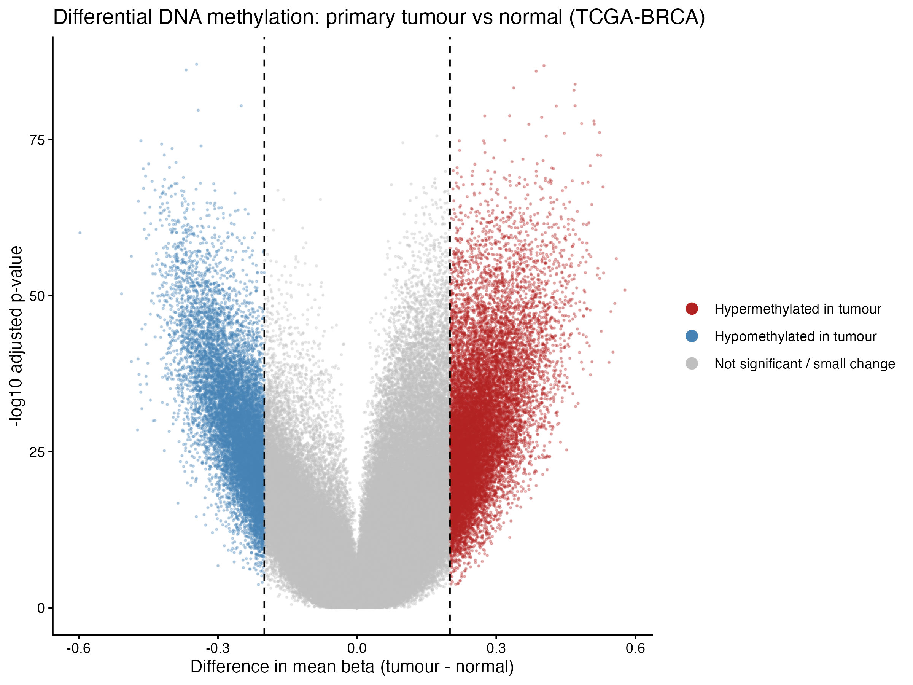
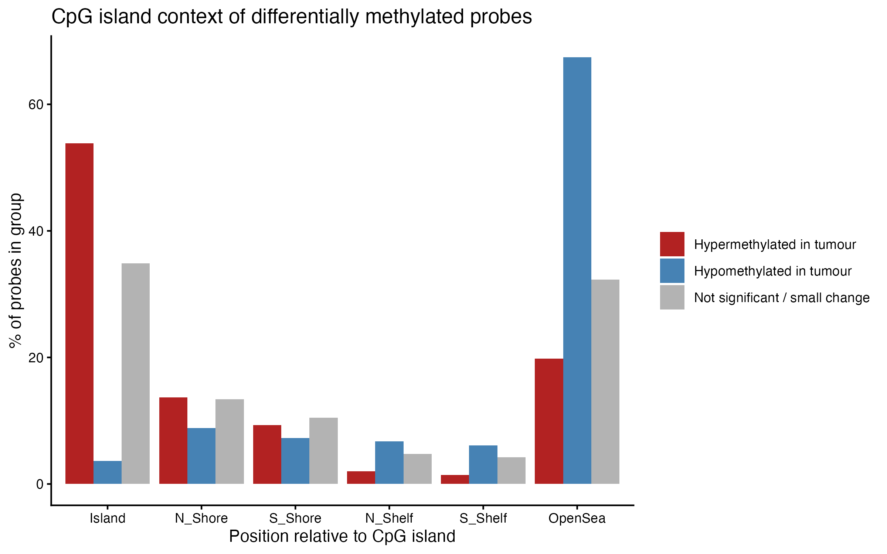
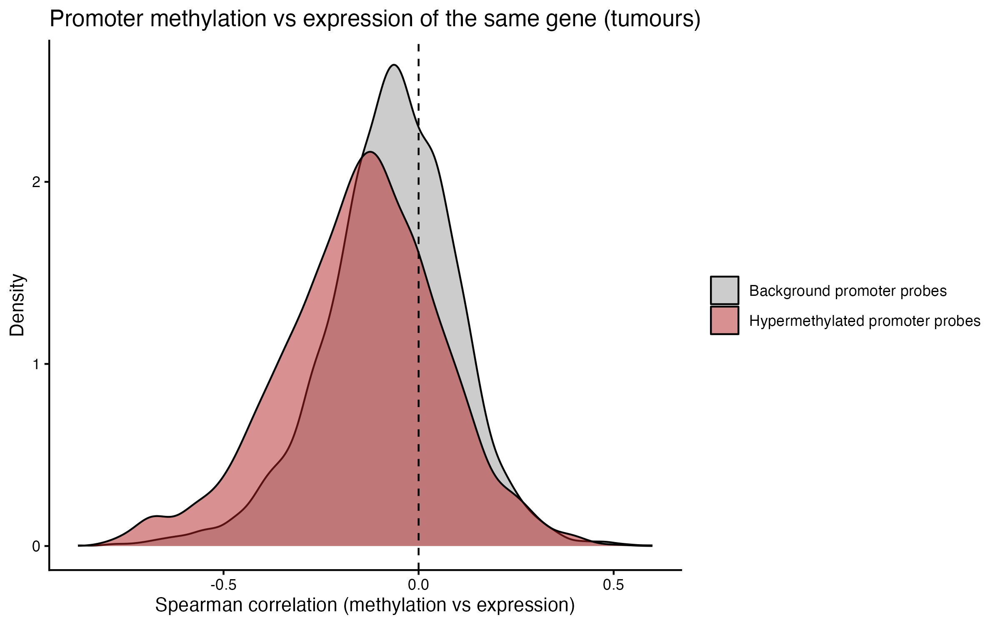

# DNA methylation in breast cancer: tumour vs normal

## Question
Which CpG sites differ in methylation between primary breast tumours and normal breast tissue, where do they sit relative to CpG islands, and is promoter hypermethylation associated with lower expression of the same gene?

This project reproduces well-documented findings; it makes no novel claim. 

## Data
- TCGA-BRCA Illumina 450k methylation (beta values), downloaded from the GDC with TCGAbiolinks: 97 normal breast samples and a random subset of 200 primary tumours (seed 42, preferring patients who also have a normal sample).
- RNA-seq (RSEM) from the TCGA PanCancer Atlas via cBioPortalData, for 199 of the tumours.

## Methods
- Probe filtering: kept CpG (cg) probes only, removed probes flagged as unreliable (sesame MASK_general), probes on chrX, chrY and chrM, and probes with more than 5% missing values (485,577 to 372,195 probes).
- Differential methylation with limma on M-values; effect size reported as the difference in mean beta (tumour minus normal). Significant = adjusted p < 0.05 and |delta beta| >= 0.2.
- CpG island context from the Illumina 450k annotation.
- For hypermethylated probes in promoters (TSS200 or TSS1500), Spearman correlation between methylation and expression of the same gene across tumours, compared with 5,000 randomly chosen unchanged promoter probes.

## Results
- Using adjusted p-value alone, 240,665 probes (65%) were significant, so an effect-size cutoff was added. With both criteria, 15,644 probes were hypermethylated and 12,175 hypomethylated in tumours.
- Hypermethylated probes were concentrated at CpG islands (53.8% vs 34.9% of unchanged probes); hypomethylated probes were concentrated in open sea (67.4% vs 32.3%), the known pattern in cancer.
- Hypermethylated promoter probes showed more negative methylation-expression correlations than background probes (median Spearman rho -0.14 vs -0.06; 21% vs 8% below -0.3), consistent with promoter methylation being associated with lower expression.

*Differential methylation, primary tumour vs normal. Dashed lines mark delta beta = +/-0.2.*

*Position relative to CpG islands, by probe group.*

*Correlation between promoter methylation and expression of the same gene, in tumours.*

## Limitations
- Tumours and normals were analysed as unpaired groups, although some patients contribute both.
- Normal and tumour tissue differ in cell composition (for example fat and stromal content), so part of the signal reflects tissue mix and not cancer-specific change.
- Only 200 of 793 tumours were used, to keep the download manageable. No covariates (age, subtype, purity) were included.
- Methylation-expression correlations may partly reflect subtype and tumour purity. Several probes can map to one gene, so probes are not independent, and only the first listed gene was used for probes mapping to several.
- Results are associations; they do not show that methylation causes silencing.
- The delta beta cutoff of 0.2 is a conventional choice, not tuned.

## Reproduce
Run `analysis.R` in R, with the working directory set to the project folder. The first run downloads about 3-4 GB from the GDC and takes a long time. The script is the working record of the analysis. Package versions are in `results/sessionInfo.txt`.
